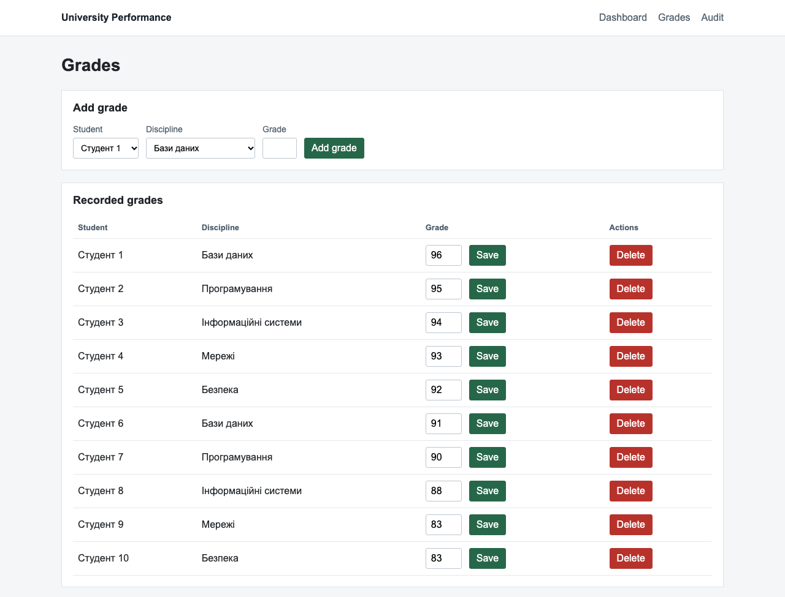
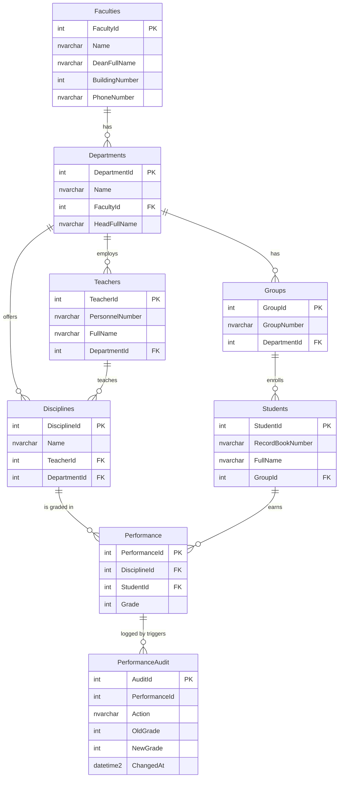

# SQL Coursework

Microsoft SQL Server coursework built around an evolving university database, from base tables through joins, grouping, security, views, functions and stored procedures.

*Lab 10: the Razor Pages application on top of the lab database. The screenshot shows demonstration data, not real student records.*

## Labs

| Lab | Topic | Main concepts |
| --- | --- | --- |
| [Lab 01](labs/lab01/) | Server environment | sqlcmd, metadata, collation |
| [Lab 02](labs/lab02/) | Database and tables | CREATE DATABASE, primary and foreign keys |
| [Lab 03](labs/lab03/) | Inserting data | INSERT, database context |
| [Lab 04](labs/lab04/) | Filtering and changes | WHERE, LIKE, UPDATE, DELETE |
| [Lab 05](labs/lab05/) | Relationships and joins | CROSS JOIN, LEFT JOIN, RIGHT JOIN |
| [Lab 06](labs/lab06/) | Security and performance | LOGIN, USER, ROLE, permissions |
| [Lab 07](labs/lab07/) | Aggregates | AVG, GROUP BY, HAVING |
| [Lab 08](labs/lab08/) | Database programming | VIEW, functions, procedures |
| [Lab 09](labs/lab09/) | Triggers and transactions | inserted, deleted, COMMIT, ROLLBACK |
| [Lab 10](labs/lab10/) | ADO.NET application | Razor Pages, SqlClient, CRUD |

## Database model

`UniversityPerformance` connects faculties, departments, groups, students, teachers, disciplines and performance records. The diagram shows every table the labs create; the [DBML file](labs/lab05/diagram.dbml) covers the first five entities.

`PerformanceAudit` is filled by the Lab 09 triggers and has no foreign key to `Performance`, so audit rows survive when a grade is deleted.

## Results

Every lab README has a **Verified output** section (Labs 02 and 05–09) or screenshots (Lab 10). They come from running the scripts in order on a fresh SQL Server 2022 instance (Developer edition in Docker) with the repository's demonstration seed. For example, the average grade is `90.50`, a `CROSS JOIN` of 3 faculties and 9 departments returns 27 rows, and a `ROLLBACK` restores a grade together with the audit row its trigger wrote.

Scripts target Microsoft SQL Server and T-SQL. Labs 02–10 form a sequence; run setup and mutation scripts only on a fresh coursework database. Seed values are demonstration data, while results labelled as current refer to the existing coursework database.
