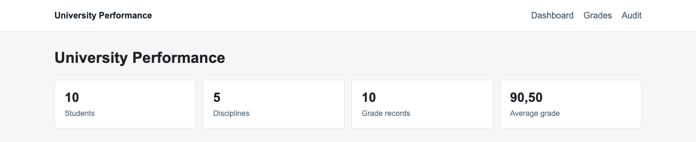
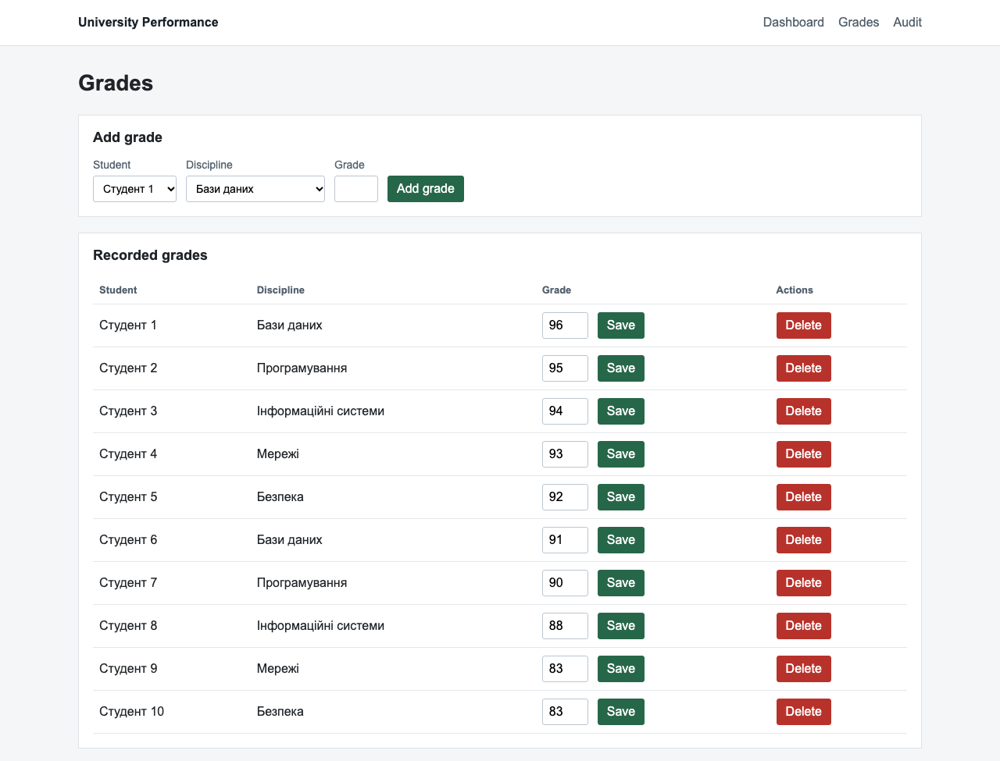
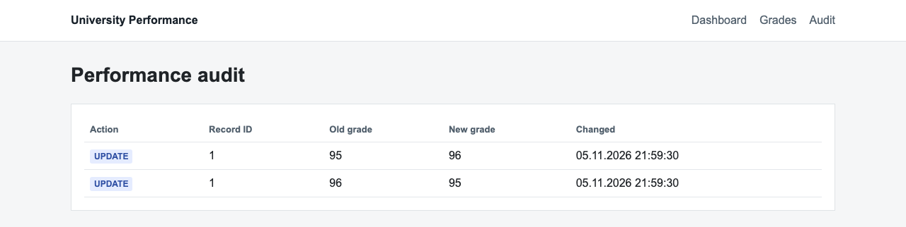

# Lab 10 — Database application with ADO.NET

## Task
Variant 1: build a usable application for the existing `UniversityPerformance` database.

## Architecture
Browser -> ASP.NET Core Razor Pages -> ADO.NET / Microsoft.Data.SqlClient -> SQL Server -> UniversityPerformance.

## Features
Dashboard metrics, a joined grades page with add, update and delete forms, and a read-only audit page.

## Screenshots
These screenshots show the application running against a fresh SQL Server 2022 instance with the demonstration data from Labs 02–09; the student names are demonstration values. The audit rows come from the Lab 09 commit example.

## ADO.NET operations
`SqlConnection` opens a database connection. `SqlCommand` holds SQL text. `ExecuteReaderAsync` reads grade and audit rows. `ExecuteNonQueryAsync` performs INSERT, UPDATE and DELETE. `ExecuteScalarAsync` returns dashboard counts. All form values are passed as parameters.

## Run
Configure `ConnectionStrings:UniversityPerformance` through .NET user-secrets or set `SQL_CONNECTION_STRING` (user-secrets take precedence when both are present), then run `dotnet run` in `src/UniversityPerformanceApp`. Credentials are not stored in the repository.
